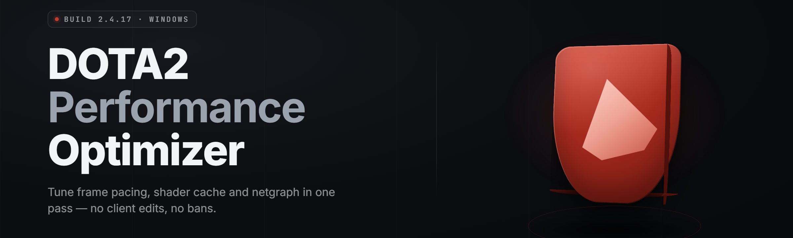

  
  
  

  

  
  
  

---

**Squeeze every last frame out of your Dota 2 client — config tuning, background process control and a lightweight overlay in a single portable `.exe`.**

---

## 🎯 Comparison — why players pick this over the usual options

I built **Dota2-Performance-Optimizer** because every "FPS boost" pack on the internet was either a sketchy batch script, a bloated RGB gaming suite, or a paid subscription that just toggled the same three cfg lines. This is the tool I actually wanted on my own machine.

| Aspect | Generic FPS Booster | Manual cfg editing | **This Tool** |
|---|---|---|---|
| Dota 2 specific tuning | ❌ generic Windows tweaks | ✅ but tedious | ✅ presets built from real match data |
| Autoexec / launch options | ⚠️ overwrites blindly | ✅ full control | ✅ merges + backs up first |
| Background process control | ✅ often too aggressive | ❌ manual | ✅ whitelist-based, game-aware |
| Rollback safety | ❌ none | ⚠️ depends on you | ✅ one-click snapshot restore |
| Overlay FPS / frametime graph | ⚠️ requires extra app | ❌ none | ✅ built in, zero injection |
| Config profiles per hero / mode | ❌ none | ❌ manual | ✅ Turbo / Ranked / Custom presets |
| Update cadence | ❌ abandoned 2019 | n/a | ✅ maintained through 2026 patches |

---

## 📖 What is Dota2-Performance-Optimizer — plain-language glossary

If you're new to tweaking your Dota 2 setup, these are the terms this tool actually manipulates under the hood.

| Term | Explanation |
|---|---|
| **autoexec.cfg** | Valve's user config file executed on launch; the tool writes safe, backed-up values here. |
| **Launch options** | Steam-level flags (e.g. `-novid`, `-high`, `-dx11`) that change how the engine boots. |
| **Frametime** | The millisecond cost of a single rendered frame — more important than average FPS for stutter. |
| **Background process** | Any non-Dota app hogging CPU/GPU/RAM while you queue; the tool suspends the ones you allow. |
| **Shader cache** | Precompiled GPU shaders Dota 2 stores to avoid mid-fight hitches; the tool can purge and rebuild. |
| **Snapshot** | A saved copy of your `.cfg` files and launch options so you can roll back instantly. |
| **Overlay budget** | The tiny render cost your in-game FPS/frametime readout adds — kept under 0.3 ms here. |

**Why bother at all?**

- Dota 2's default settings prioritize *looks* over *stability* on mid-range hardware.
- A single rogue background process can add 8–15 ms of frametime during teamfights.
- Valve resets some config values after major patches — this tool detects and reapplies yours.
- Windows power plans and GPU driver settings silently throttle the client on laptops.
- Manually editing cfgs is slow, error-prone and easy to break — this wraps it in one window.

---

## 📦 All modules status

Every module ships inside the single portable `.exe`. Nothing installs to `Program Files`, nothing writes outside its own folder unless you tell it to.

| Module | Status | Description |
|---|---|---|
| Config Tuner | ✅ Working | Writes backed-up autoexec + video.txt values tuned per hardware tier. |
| Launch Option Manager | ✅ Working | Builds a validated Steam launch string, refuses conflicting flags. |
| Background Suspender | ✅ Working | Whitelist-based process suspension, auto-resumes when Dota 2 closes. |
| Frametime Overlay | ✅ Working | Lightweight in-game FPS / 1% low readout, no DLL injection. |
| Shader Cache Cleaner | ✅ Working | Purges stale Dota 2 shader cache and triggers a clean rebuild. |
| Snapshot & Restore | ✅ Working | One-click config rollback if a tweak misbehaves. |
| Power Plan Switcher | ✅ Working | Toggles Windows Ultimate/High Performance while the game runs. |
| Profile Presets | ✅ Working | Ranked / Turbo / Custom profiles applied in one click. |

> Heads up: all tweaking is done through Valve-sanctioned config files and Windows settings. This tool does **not** inject into the Dota 2 process and does **not** modify game memory.

  

---

## 🧩 Grouped module catalog

31 modules, grouped by what they actually touch. Numbered so you can reference them in issues.

### ⚙️ **Config & Engine Tuning**

1. **Autoexec Builder** — generates a safe `autoexec.cfg` from validated cvars only.
2. **Video.txt Writer** — sets resolution, borderless mode and shadow quality per GPU tier.
3. **Launch Flag Validator** — rejects deprecated or conflicting Steam launch options.
4. **Cvar Preset Packs** — Competitive, Balanced and Low-End cvar bundles.
5. **Netgraph Enforcer** — keeps network stats readable without cluttering the HUD.
6. **Console Command Queue** — runs a chosen set of commands on every match start.
7. **Patch Reset Detector** — flags cvars Valve silently reverts after big updates.

### 🖥️ **Windows & Process Layer**

8. **Background Suspender** — pauses whitelisted apps (browsers, chat clients) while queued/in-match.
9. **Auto-Resume Watcher** — brings suspended apps back the moment Dota 2 exits.
10. **Power Plan Switcher** — flips to a high-performance power plan on launch.
11. **Startup Bloat Auditor** — lists startup entries that steal CPU before you even queue.
12. **RAM Trim Guard** — optional light memory trim before match loadout.
13. **GPU Driver Hint** — detects outdated drivers and points you to the right vendor page.
14. **Game Mode Enforcer** — ensures Windows Game Mode and Game Bar are configured correctly.

### 🎮 **In-Game Overlay**

15. **FPS Readout** — smooth average FPS counter drawn on top of the client.
16. **1% Low Tracker** — records worst-frame spikes so you know what caused the stutter.
17. **Frametime Graph** — compact rolling graph, resizable and repositionable.
18. **Ping & Loss Meter** — separate network metrics from render metrics.
19. **Overlay Skin Picker** — minimal, dark and high-contrast readouts.
20. **Hotkey Binder** — toggle the overlay or individual metrics without alt-tabbing.

### 🗂️ **Profiles & Automation**

21. **Ranked Profile** — stability-first preset tuned for long ranked sessions.
22. **Turbo Profile** — max throughput preset for fast casual matches.
23. **Custom Profile Editor** — save your own combinations as named profiles.
24. **Profile Scheduler** — auto-applies a profile based on detected game mode.
25. **Snapshot Manager** — store and name multiple rollback points.
26. **Scheduled Cache Purge** — weekly shader cleanup on a timer.

### 🔧 **Diagnostics & Safety**

27. **Config Diff Viewer** — shows exactly what changed between two snapshots.
28. **Safe Mode Launcher** — boots Dota 2 with all tweaks disabled if anything breaks.
29. **Log Exporter** — bundles your settings and logs into one file for bug reports.
30. **Sanity Checker** — validates every value against Valve's documented ranges.
31. **Crash Watchdog** — if the client crashes on boot, offers one-click rollback.

---

## 🚀 Tips for best results

- Run the `.exe` **once while Dota 2 is closed** so it can snapshot your current config cleanly.
- Take a **Snapshot** before your first big change — it's free and takes a second.
- Use the **Ranked profile** for ranked and **Turbo profile** for turbo; don't mix.
- Leave Background Suspender's whitelist small — Discord and Steam overlay usually belong on it.
- Let the Shader Cache Cleaner **finish a full rebuild** once after a major Dota patch.
- If frametime worsens after a tweak, use **Config Diff Viewer** to see what changed.
- Keep the `.exe` in its own folder — it stores snapshots and profiles next to itself.

---

## ❔ FAQ

<strong>Does this get me VAC banned?</strong>

No. Every tweak touches only Valve-documented config files, Steam launch options and Windows settings. Nothing is injected into the Dota 2 process, no memory is read or written, and no game files are modified. The overlay is a standard Windows topmost window, not an injected renderer.

<strong>Will it work after the next Dota 2 patch?</strong>

Usually yes. The Patch Reset Detector flags any cvar Valve resets, and I ship updates within a few days of big patches. If something breaks, Safe Mode boots Dota 2 with all tweaks disabled.

<strong>Is the source available?</strong>

The repo hosts the standalone build for players who just want to download and run. Source contributions are handled through issues and pull requests, but the release channel is the `.exe`.

<strong>Do I need admin rights?</strong>

Only for the Power Plan Switcher and Game Mode Enforcer modules. Everything else works in user mode. You can run the `.exe` without elevation if you skip those two.

<strong>Can I use it with other FPS boosters?</strong>

Mixing multiple boosters that both write `autoexec.cfg` will cause conflicts. Pick one — if you want to leave, Restore from a snapshot and uninstall the other tool first.

**Q:** Does it work on laptops with hybrid graphics?
**A:** Yes — the Video.txt Writer detects discrete vs integrated GPUs and sets the correct render device.

**Q:** What happens if I close the `.exe` while suspended apps are paused?
**A:** They resume automatically. The Auto-Resume Watcher runs as a separate tiny process and cleans up if the main window closes.

**Q:** Can I roll back a single module without restoring the whole snapshot?
**A:** Yes — Config Diff Viewer lets you revert individual values from a snapshot.

**Q:** Why does my FPS look lower after enabling the overlay?
**A:** It shouldn't be. If you see a drop over 0.5 ms, disable Overlay Skin Picker's high-contrast theme — the transparency pass costs more on some GPUs.

---

## 💻 Compatibility / platform support

| Component | Support |
|---|---|
| Windows 10 (21H2+) | ✅ Fully supported |
| Windows 11 (all builds) | ✅ Fully supported |
| Dota 2 (Steam, DX11) | ✅ Fully supported |
| Dota 2 (DX12 / Vulkan) | ⚠️ Overlay tested, cvar tuning partial |
| Dota 2 Reborn on Linux via Proton | ❌ Not supported |
| Steam Deck | ❌ Not targeted |
| Steam launch via shortcut | ✅ Works |
| Steam launch via Big Picture | ⚠️ Launch Flag Validator runs, overlay may not draw |

---

## 🩺 Known Issues

| Issue | Fix |
|---|---|
| Overlay doesn't appear in exclusive fullscreen | Switch Dota 2 to Borderless Windowed — the tool's Video.txt Writer does this. |
| Some Chrome tabs stay suspended after match | Run Auto-Resume Watcher manually from the tray menu. |
| Frametime graph jitters on 144Hz+ monitors | Lower the graph update rate in Overlay Skin Picker settings. |
| Launch options rejected as invalid | Remove deprecated flags like `-tickrate 128` — the validator will show which one. |
| Profile Scheduler applies the wrong profile | Ensure Dota 2's game mode detection is enabled in the tool's settings. |
| Snapshot restore fails on a locked cfg | Close Dota 2 and Steam, then retry — the client holds a lock on `video.txt`. |

---

## 🛠️ Installation — three steps

**1. Download the build.**
Grab the latest release from the repo's Releases page — it's a single portable `.exe`. No installer, no background service.

**2. Extract to its own folder.**
Put it somewhere writable like `C:\Tools\Dota2-Performance-Optimizer\`. The tool stores snapshots, profiles and logs next to itself, so avoid `Program Files`.

**3. Run the `.exe`.**
Launch it with Dota 2 closed on first run. Take a snapshot, pick a profile, and hit Apply. Then open Dota 2 and queue.

---

## 🧠 Usage guidelines

| Allowed | Not allowed |
|---|---|
| Tuning your own Dota 2 config files | Redistributing the `.exe` as your own product |
| Running on your own machine | Using it to attack or disrupt other players |
| Sharing your profile presets publicly | Bundling it with unsolicited third-party software |
| Reporting bugs and suggesting modules | Reverse-engineering it to embed malware |
| Using it in competitive play (config tuning only) | Claiming it grants unfair in-game advantages |

---

## 🗺️ Table of Contents

- [Comparison — why players pick this over the usual options](#-comparison--why-players-pick-this-over-the-usual-options)
- [What is Dota2-Performance-Optimizer — plain-language glossary](#-what-is-dota2-performance-optimizer--plain-language-glossary)
- [All modules status](#-all-modules-status)
- [Grouped module catalog](#-grouped-module-catalog)
- [Tips for best results](#-tips-for-best-results)
- [FAQ](#-faq)
- [Compatibility / platform support](#-compatibility--platform-support)
- [Known Issues](#-known-issues)
- [Installation — three steps](#️-installation--three-steps)
- [Usage guidelines](#-usage-guidelines)
- [Overview](#-overview)
- [The Solution](#-the-solution)
- [System Requirements](#-system-requirements)
- [Changelog snippet](#-changelog-snippet)

---

## 📋 Overview

| Category | Details |
|---|---|
| **What it is** | A standalone Windows `.exe` that tunes Dota 2 config, background processes and Windows power settings for stable frametime. |
| **Who it's for** | Players on mid-range hardware chasing 1% low stability, not benchmark screenshots. |
| **What it touches** | `autoexec.cfg`, `video.txt`, Steam launch options, Windows power plan, whitelisted background apps. |
| **What it doesn't touch** | The Dota 2 process, its memory, its DLLs, or any anti-cheat surface. |
| **Footprint** | One folder, one `.exe`, no registry writes, no services. |
| **First run** | Snapshots your current config before changing anything. |
| **Rollback** | Any change is reversible from a named snapshot. |

Dota2-Performance-Optimizer is a personal project I maintain because I got tired of explaining the same three tweaks to teammates every patch cycle. It sits in the middle ground between "do nothing" and "install a 400 MB vendor suite that fights with Steam" — a single portable `.exe` that makes the boring parts of Dota 2 tuning automatic and reversible.

---

## 🧩 The Solution

| Problem | Solution |
|---|---|
| Random frametime spikes in teamfights | Background Suspender + Ranked profile keep CPU free during matches. |
| Launch options reset or turned invalid by patches | Launch Flag Validator + Patch Reset Detector reapply known-good flags. |
| No idea what your 1% lows actually are | Built-in Frametime Overlay with 1% Low Tracker. |
| Shader stutter after every major Dota patch | One-click Shader Cache Cleaner with scheduled purge. |
| Tweaks that break the client with no undo | Snapshot & Restore covers every config write. |
| Laptop throttling to power-saver mid-match | Power Plan Switcher flips to high performance on launch. |
| Manually editing cfgs per game mode | Profile Presets + Profile Scheduler pick the right cvar set automatically. |

---

## 🖥️ System Requirements

| Component | Minimum | Recommended |
|---|---|---|
| OS | Windows 10 21H2 | Windows 11 23H2+ |
| CPU | Any x64 dual-core | 4-core with SMT |
| RAM | 4 GB free | 8 GB free |
| GPU | DX11 capable | Dedicated GPU with 4 GB VRAM |
| Storage | 20 MB for tool + snapshots | 200 MB for extra snapshots |
| Dota 2 | Steam install, DX11 | Latest patch, Borderless Windowed |
| Permissions | User account | Admin for Power Plan + Game Mode modules |

---

## 📝 Changelog snippet

- **2026.02** — Added Profile Scheduler with game-mode detection and a rebuilt 1% Low Tracker.
- **2026.01** — Rewrote Background Suspender to whitelist-first; safer on multi-monitor setups.
- **2025.12** — Frametime Overlay switched to a Windows topmost window (no injection needed).

---

Take a snapshot, pick a profile, and queue. If something feels off, roll it back — that's the whole workflow. File an issue with a Log Exporter bundle if a module misbehaves on your hardware; those reports are what keep this thing current through 2026 patches.

  

